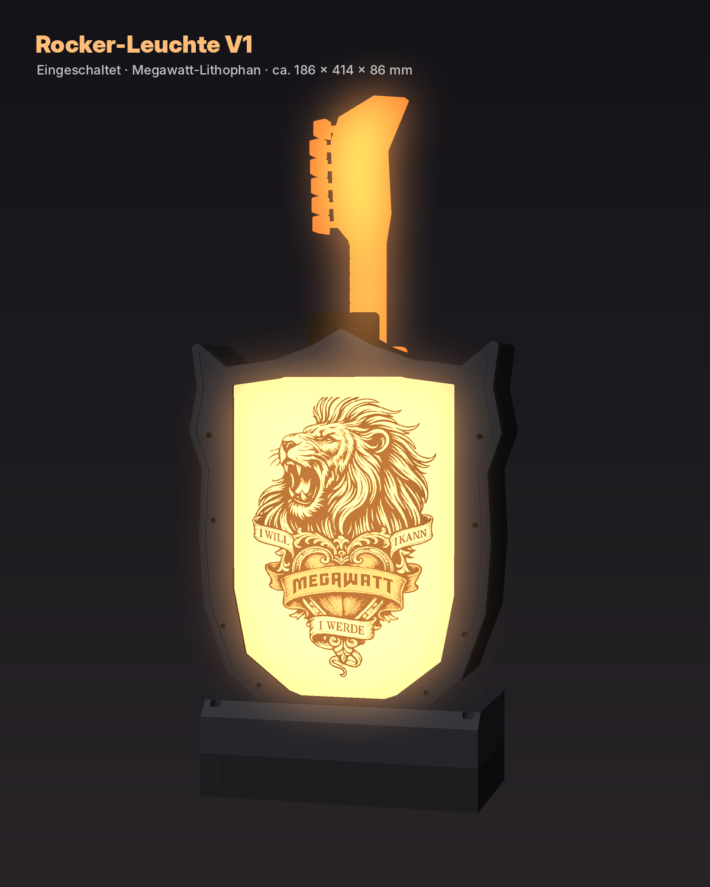
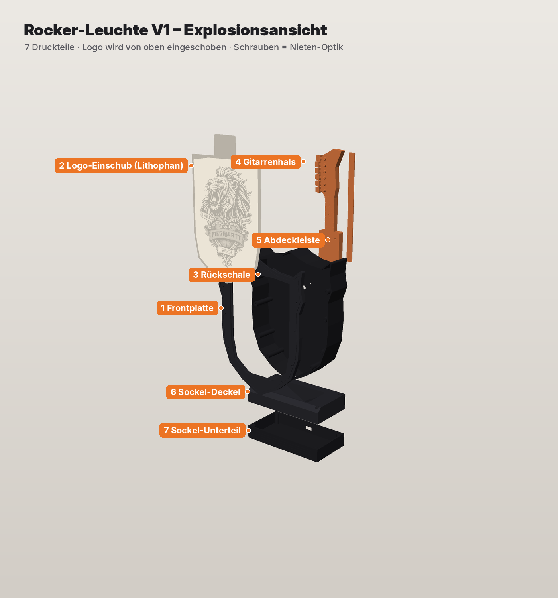

<h1 align="center">🎸 Rocker-Leuchte</h1>

  <b>Wappen-Leuchte mit wechselbarem Band-Logo und leuchtendem Gitarrenhals.</b> 
  ESP32 · WS2812B · WLED · 3D-Druck – ein Projekt von <a href="https://github.com/Loetlicht">Lötlicht</a>

  
  
  

  
  

---

## Die Idee

Eine Leuchte in Wappenform für das Logo deiner Lieblingsband. Das Logo sitzt als **Lithophan** auf einer Platte, die von oben eingeschoben wird. So lässt es sich in Sekunden austauschen. Hinter der Leuchte ragt ein **Gitarrenhals** mittig nach oben heraus, der ebenfalls leuchtet.

Gesteuert wird alles von einem **ESP32 mit WLED**: Farben, Effekte und Helligkeit stellst du bequem am Handy ein.

### Zwei Varianten

| Variante | Besonderheit |
|---|---|
| **V1 Rocker** | Wappen-Gehäuse mit Nieten-Optik, Einschub-Logo, leuchtender Gitarrenhals, Sockel mit Platz für den ESP32 |
| **V2 Art-Deco** | Gestufte Spitzbogen-Form, komplette Frontplatte mit Magneten (6 × 3 mm) zum Wechseln |

---

## Teileliste (geplant)

| Teil | Menge | Hinweis |
|---|---|---|
| ESP32 (Mini oder WROOM) | 1 | WLED-Firmware |
| WS2812B LED-Streifen, 60 LED/m | ca. 1 m | umlaufend im Gehäuse + Gitarrenhals |
| Netzteil 5 V, min. 3 A | 1 | je nach LED-Anzahl |
| Kondensator 1000 µF / 10 V | 1 | über die 5-V-Versorgung des Streifens |
| Widerstand 330 Ω | 1 | in der Datenleitung |
| Neodym-Magnete 6 × 3 mm | 4 | nur V2 |
| Filament PETG/PLA (schwarz) | – | Gehäuse |
| Filament weiss | – | Lithophan-Platte |
| Filament transparent | – | Gitarrenhals |

---

## Projektstand

- [x] Konzept und Design ([Konzeptbild](docs/konzept.jpg))
- [x] STL-Dateien Gehäuse V1 Rocker
- [x] STL-Dateien Gitarrenhals
- [x] Logo-Lithophan-Platte (Megawatt als erstes Logo)
- [ ] STL-Dateien V2 Art-Deco mit Magnet-Front
- [x] Generator-Skript: eigenes Logo → Lithophan-Platte
- [ ] WLED-Konfiguration und Verdrahtung
- [ ] Bauanleitung mit Fotos

---

## Ordner

| Ordner | Inhalt |
|---|---|
| [`stl/`](stl/) | Druckdateien, Kleinteile und Zusammenbau |
| [`cad/`](cad/) | Python-Quellcode der Teile und Logo-Generator |
| [`firmware/`](firmware/) | WLED-Einrichtung und Pinbelegung |
| [`docs/`](docs/) | Bilder und Anleitungen |

---

## Hinweis zu Logos

Band-Logos sind geschützt. Lade hier nur Logos hoch, die du verwenden darfst – für deine eigene Leuchte zu Hause kannst du mit dem Generator jedes Logo selbst in eine Platte umwandeln.

<i>Mehr Projekte auf TikTok: <a href="https://www.tiktok.com/@loetlicht">@loetlicht</a> 🔥</i>

